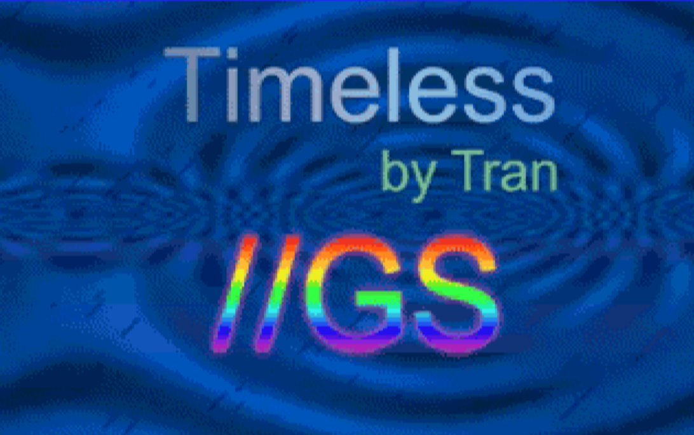
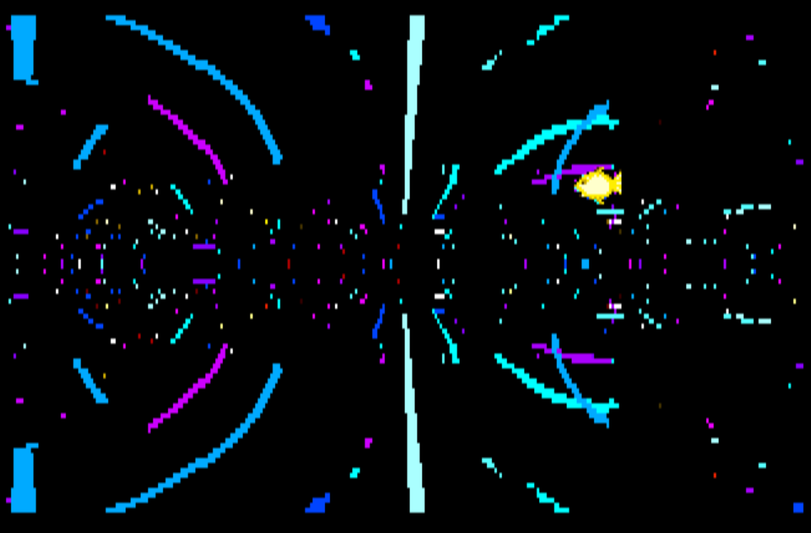
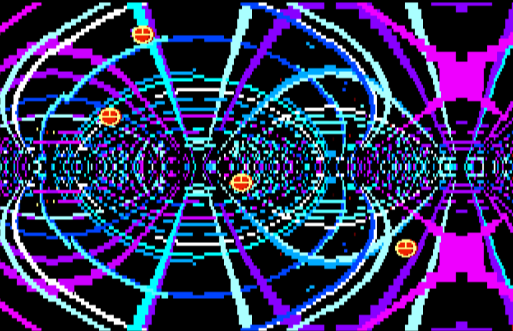
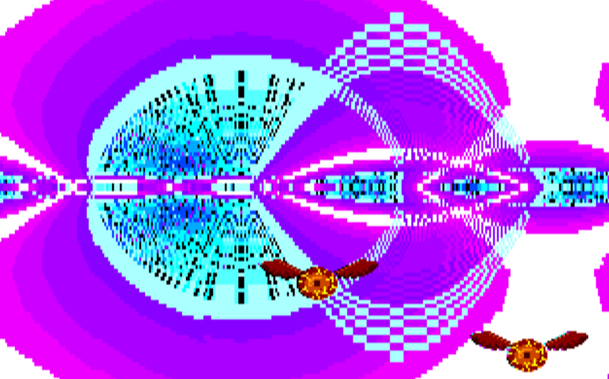
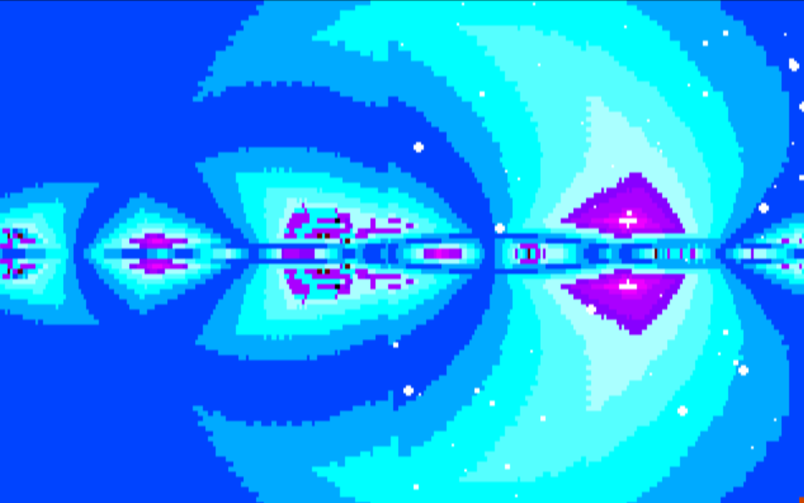

# Timeless\_IIgs

I.Ci.A.  Italia  (30 year later)

Proudly Presents   Timeless //GS

with thanks to :

Thomas Pytel (Tran himself, the one and only)

David Ashley (SDL port in C)

Antoine Vignau  and Olivier Zardini (Brutal Deluxe for Merlin32) 

Jesse Blue (NinjaForce for NinjaTrackerPlus)

Ian Brumby  (CrossRunner emulator)

Dagen Brock (Digarok for inspiration, BuckShot and GSPlus emulator)

Jawaid Bazyar  (Baz for inspiration and GSSquared emulator) 

Vince Weaver (Deater for inspiration and various Demake)

Olivier Goguel  and FTA for Golden Years

Claude and Gemini (!)

and as always 

great hello to Dadopado and CCSuperstar !

19/10/2026  Dark Phoenix and Homer (homer.control@gmail.com)

